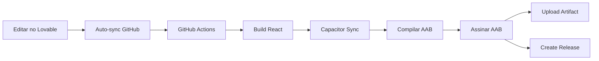

# CI/CD Automático - Geração de AAB

Este workflow gera automaticamente arquivos AAB (Android App Bundle) para publicação na Play Store sempre que você faz push para a branch main.

## 📋 Pré-requisitos

1. **Conectar ao GitHub**
   - Clique em "GitHub" → "Connect to GitHub" no Lovable
   - Autorize e crie o repositório

2. **Criar Keystore**
   - Use o comando abaixo para criar seu keystore:
   ```bash
   keytool -genkey -v -keystore keystore.jks -keyalg RSA -keysize 2048 -validity 10000 -alias upload
   ```
   - Guarde as senhas em local seguro

3. **Configurar Secrets no GitHub**
   - Vá em: Repositório → Settings → Secrets and variables → Actions
   - Adicione os seguintes secrets:

   | Secret | Descrição | Como obter |
   |--------|-----------|------------|
   | `KEYSTORE_BASE64` | Keystore codificado | `base64 -i keystore.jks` |
   | `KEYSTORE_PASSWORD` | Senha do keystore | A que você definiu |
   | `KEY_ALIAS` | Alias da chave | `upload` (ou o que você definiu) |
   | `KEY_PASSWORD` | Senha da chave | A que você definiu |

## 🚀 Como Usar

### Automático (Recomendado)
1. Faça suas alterações no Lovable
2. As mudanças sincronizam automaticamente com GitHub
3. O workflow inicia automaticamente
4. AAB estará disponível em ~10 minutos

### Manual
1. Vá em: Actions → Build Android AAB → Run workflow
2. Aguarde a conclusão (~10 minutos)
3. Baixe o AAB dos artifacts

## 📦 Onde Encontrar o AAB

### Opção 1: Artifacts (temporário - 30 dias)
1. Vá em: Actions → Clique no workflow executado
2. Seção "Artifacts" → Download `app-release-XXX`

### Opção 2: Releases (permanente)
1. Vá em: Releases
2. Baixe o AAB da versão mais recente

## 🔄 Fluxo Completo



## ⚠️ Troubleshooting

### Build falha com erro de assinatura
- Verifique se os secrets estão corretos
- Certifique-se de que o KEYSTORE_BASE64 foi gerado corretamente

### Build falha na compilação
- Verifique erros de TypeScript no Lovable
- Certifique-se de que `npm run build` funciona localmente

### AAB não aparece nos artifacts
- Verifique se o build passou sem erros
- Confirme que o workflow completou todas as etapas

## 📱 Publicar na Play Store

1. Baixe o AAB mais recente dos artifacts/releases
2. Acesse [Google Play Console](https://play.google.com/console)
3. Vá em: Seu App → Produção → Criar nova versão
4. Faça upload do AAB
5. Complete as informações e publique

## 🔧 Customização

### Mudar versão do build
Edite `android/app/build.gradle`:
```gradle
versionCode 1
versionName "1.0.0"
```

### Build apenas em tags
Mude o trigger no workflow:
```yaml
on:
  push:
    tags:
      - 'v*'
```

### Notificações no Discord/Slack
Adicione steps de notificação no final do workflow.
